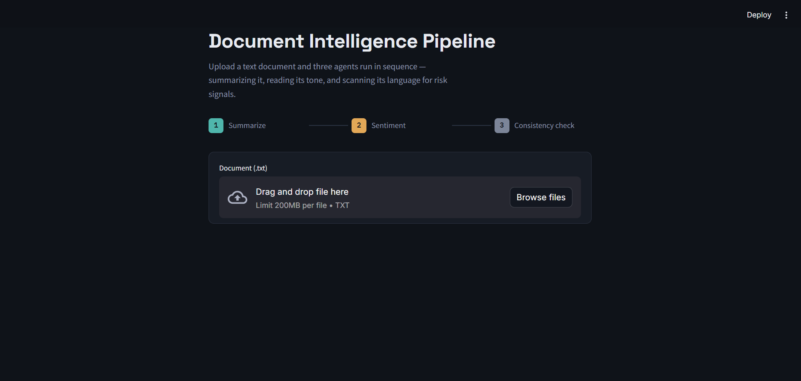
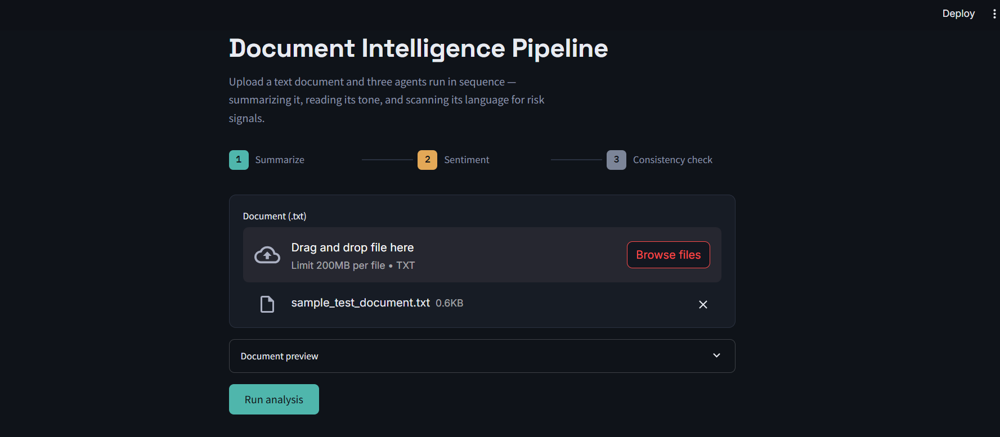
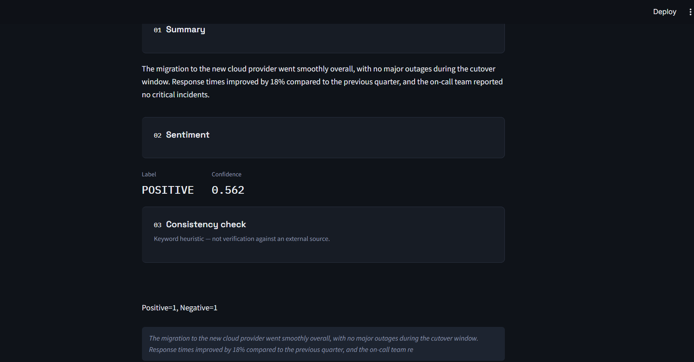

# DocuLens: Multi-Agent Document Intelligence Pipeline


DocuLens is a Streamlit app that looks at a plain-text document through three lenses, run in sequence by a coordinator: it summarizes the text, classifies its sentiment, and scans its language for risk signals.

---

## Overview

Upload a `.txt` file and DocuLens passes it through three agents:

| Stage | Agent | What it does |
|-------|-------|--------------|
| 1 | Summarizer | Generates a short summary with `facebook/bart-large-cnn` |
| 2 | Sentiment | Returns a sentiment label and confidence score with `cardiffnlp/twitter-roberta-base-sentiment-latest` |
| 3 | Consistency checker | Scores positive vs. risk-indicating keywords and returns a verdict, analysis and evidence |

The consistency checker is a lightweight keyword heuristic. It does not verify claims against any external source.

---

## Screenshots

### Document preview


### Upload a document


### Analyzed results


---

## How It Works

- `coordinator.py` runs the agents in order: summarize, sentiment, consistency check. The consistency checker also receives the summary as context.
- Each agent call is wrapped so that a failure in one (for example, a model download error) does not stop the pipeline. The failed agent returns an `error` entry and the others still return results.
- `app.py` is the Streamlit front end: file upload, document preview, a stage strip, and one result panel per stage.
- `config.py` holds model names, length limits and keyword lists. Several can be overridden with environment variables.

## Project Structure

```
doculens-multi-agent/
├── app.py            # Streamlit UI
├── coordinator.py    # Runs the agent pipeline
├── config.py         # Models, limits, keyword lists, logging
├── agents/           # Summarizer, sentiment and consistency-check agents
├── tests/            # Tests (pytest)
├── Screenshots/      # App screenshots
├── Dockerfile
├── requirements.txt
└── LICENSE
```

## Tech Stack

- Python 3.11
- Streamlit
- Hugging Face Transformers and PyTorch
- Docker
- pytest

## Requirements

- Python 3.11
- Dependencies listed in `requirements.txt`

The Hugging Face models are downloaded on first use, so the first run needs an internet connection and takes longer.

## Getting Started

### Run Locally

```bash
git clone https://github.com/Chowdri-Furkhan07/doculens-multi-agent.git
cd doculens-multi-agent
python -m venv venv
source venv/bin/activate        # Windows: venv\Scripts\activate
pip install -r requirements.txt
streamlit run app.py
```

Open http://localhost:8501.

### Run with Docker

```bash
docker build -t doculens .
docker run -p 8501:8501 doculens
```

## Usage

1. Upload a UTF-8 `.txt` file.
2. Optionally expand the document preview.
3. Click **Run analysis**.
4. Read the three result panels: Summary, Sentiment (label and confidence), and Consistency check (verdict, analysis, evidence).

Empty files and files that are not valid UTF-8 are rejected with a message.

## Configuration

Set these environment variables to override the defaults in `config.py`:

| Variable | Default | Purpose |
|----------|---------|---------|
| `SUMMARIZER_MODEL` | `facebook/bart-large-cnn` | Summarization model |
| `SENTIMENT_MODEL` | `cardiffnlp/twitter-roberta-base-sentiment-latest` | Sentiment model |
| `SUMMARY_MAX_LENGTH` | `100` | Maximum summary length |
| `SUMMARY_MIN_LENGTH` | `30` | Minimum summary length |
| `LOG_LEVEL` | `INFO` | Logging level |

The summarizer input window is set to 1024 characters and the sentiment input window to 512 characters. The positive and risk keyword lists used by the consistency checker are also defined in `config.py`.

## Testing

```bash
pytest
```

## Limitations

- Accepts plain `.txt` files only.
- The consistency check is keyword-based and can miss context or misread tone.
- Sentiment and summarization quality depend on the underlying pretrained models.

## Author

**Chowdri Furkhan**

B.E. in Artificial Intelligence and Machine Learning, Bengaluru, India

GitHub: [@Chowdri-Furkhan07](https://github.com/Chowdri-Furkhan07)

## License

Released under the MIT License. See [LICENSE](LICENSE).
